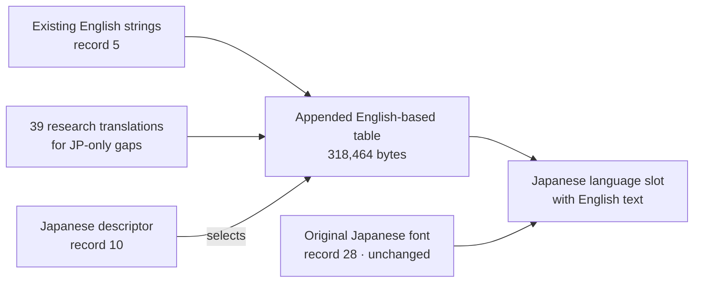

<p align="center">
  
</p>

<h1 align="center">OM-5 Mark II · JP English Research</h1>

<p align="center">
  <strong>Reproducible English menus through a narrow resource change.</strong><br>
  Native E148 · Official firmware 1.1 · Python 3.9+ · Apache-2.0
</p>

<p align="center">
  <a href="#the-result">The result</a> ·
  <a href="#how-it-works">How it works</a> ·
  <a href="#quick-start">Quick start</a> ·
  <a href="#evidence-and-limits">Evidence</a> ·
  <a href="AGENT_CONTEXT.md">For AI agents</a>
</p>

---

## The result

**One owner of a Japanese-market OM-5 Mark II reported a normal boot and English menus after installing the resource-only r01 output.** Subsequent functional testing was partial, with no issue reported in the subset tried. The completed subset was not specified.

This repository explains the experiment and provides the source code, tests and exact hashes needed to reproduce its bytes offline. It contains **no firmware binaries**, full vendor string tables or font blobs.

| Target | Change | Current evidence |
| :--- | :--- | :--- |
| Native **OM-5 Mark II / E148**, official **1.1** | Japanese string descriptor selects an English-based resource; original JP font retained | **1 owner-reported camera**; partial post-install acceptance |
| Resource component **0101** only | **4,909** string IDs, including **39 research translations** | **41/41 offline tests** in recorded Windows and Linux reviews |

> [!WARNING]
> **Experimental research, not a generally validated firmware release.** Even a resource-only update erases the entire selected 12 MiB range before writing and can leave a camera unbootable. Recovery after damaged resources is unknown. Full UI coverage and long-term reliability have not been established.

**Compatibility is deliberately narrow.** This result does not cover the original OM-5 / E144, an OM-5-to-Mark-II port, or another firmware build. A successful build or checksum is not permission to install anything.

## Why this exists

The goal was an English interface on a Japanese-market body while changing as little of the firmware as practical. The official E148/1.1 update already contains English strings. That makes it possible to investigate replacing the text selected by the Japanese language slot while retaining its existing font.

The owner first completed the official update from 1.0 to 1.1 and confirmed normal baseline operation. After offline analysis and independent review, the owner authorized and performed one trial of the exact resource-only r01 artifact. The [hardware report](docs/hardware-result.md) separates that physical account from the software checks.

This is **English text in the Japanese slot**. It does not demonstrate a changed factory region or an unlocked language selector. No OMKit loader or executable component is included in the installed package.

## How it works



1. **Verify the exact stock input.** Size, SHA-256, native model, component layout, checksums, resource ranges and font identity must match.
2. **Build the English-based table.** Copy the existing English text and pointers, then replace exactly 39 gap-entry pointers with research-authored translations. Preserve icon escapes, controls and Japanese font metadata.
3. **Redirect the Japanese record.** Append the table in verified zero-filled reserve and rewrite the descriptor's eight-byte source/span field; four byte values differ. All other resource records remain unchanged.
4. **Verify and extract.** Recompute the resource checksum, reparse the result, check all other components and require the pinned hashes. Extract only component 0101 into the 12 MiB research output.

The new table fits within the native 392,192-byte string buffer, leaving 73,728 bytes of headroom. Valid pointers and glyphs do not prove every line fits every screen.

→ [Exact offsets and expected bytes](docs/design.md) · [The 39 non-vendor translations](data/english_gap_translations.json)

## Quick start

**No camera is needed.** Use Python **3.9+** and its standard library. Run these commands from the repository root.

### 1. Run the tests without firmware

```sh
python -B -m unittest discover -s tests -v
```

Expected without an external input: **39 passed, 2 integration tests skipped**. A skipped integration test does not establish a successful firmware rebuild.

### 2. Reproduce r01 in memory

Obtain your own exact official E148/1.1 input and compare it with the [artifact hashes below](#artifact-identity). The repository does not download firmware.

```sh
python -B tools/reproduce.py --stock /path/to/OLY_E_148_1100_0000_0000.BIN
```

The command validates the input, reconstructs r01 and prints a JSON report. **By default it writes no firmware and has no device access.** Expect `files_written: 0`, `resource_bytes: 12582912`, the pinned r01 hash and `hardware_safety_proven: false`.

<details>
<summary><strong>Run the complete 41-test suite with the exact input</strong></summary>

PowerShell:

```powershell
$env:OM5_TEST_STOCK='D:\firmware\stock.BIN'
python -B -m unittest discover -s tests -v
```

POSIX shell:

```sh
OM5_TEST_STOCK=/path/to/stock.BIN python -B -m unittest discover -s tests -v
```

The recorded independent reviews passed **41/41** on Windows with Python 3.9.13 and Ubuntu 22.04 with Python 3.10.12. These are recorded results, not a live CI status.

</details>

<details>
<summary><strong>Optionally save research outputs to a new local directory</strong></summary>

```sh
python -B tools/reproduce.py --stock /path/to/stock.BIN --output-dir /path/to/new-research-output
```

The directory must not exist; its parent must exist. Choose an ordinary local research location outside the checkout and any publication archive.

| Output | Purpose |
| :--- | :--- |
| `JP_EN_resources.research-bin` | Pinned r01 resource-only output |
| `STOCK_resources.research-bin` | Matching stock resource reference; not an independent rescue loader |
| `build.json` | Input/output hashes and construction details |

Files are staged, closed and checked by disk size/SHA-256 before final names appear. If `.INCOMPLETE` remains after an error, the output set is unfinished. Multi-file finalization is not a filesystem transaction.

The tool has no camera transport, SD discovery, updater filenames or automatic installation. Path checks are not a device sandbox: choose a local research directory explicitly. Keep generated firmware out of published repositories and archives.

</details>

> [!IMPORTANT]
> If an input, layout or digest check fails, stop and investigate. Do not disable a guard or replace the expected hash simply to accept a different file. A changed translation or build is a new candidate requiring separate evidence.

## Evidence and limits

| What was checked | What it supports | What it does not establish |
| :--- | :--- | :--- |
| Exact reconstruction and byte comparison | The published code reproduces the owner-tested r01 bytes | Safety on another camera |
| 41 offline tests with the exact input | Parser, transformation and CLI checks, including failure cases | Complete physical-camera behavior |
| Historical native lookup across 4,909 IDs and selected UI paths | Operation of those paths in the modeled environment | A complete camera boot, every screen or peripheral |
| Owner-reported normal boot and English menus | Feasibility on one Japanese-market body | General compatibility or full UI coverage |
| Owner-reported partial functional pass | No issue in the unspecified subset tried | A completed acceptance checklist or long-term reliability |

Earlier emulator work used synthetic settings, substituted resource reads and modeled peripherals. Some startup/UI paths remained unresolved for stock as well as candidate. Raw emulator harnesses and logs are not bundled here; this export reproduces the transformation and parser tests.

The reviewed r01 physical trial procedure is **not included**. The historical report cites OMKit's updater description, which belongs to a different loader installation procedure. No independent screen recording, flash readback or failed-resource recovery experiment was performed.

→ [Validation and recovery limitations](docs/validation.md) · [One-camera report](docs/hardware-result.md)

## Read more

| Start here if you want to… | Document |
| :--- | :--- |
| Read the illustrated story as a standalone page | [HTML field guide](START_HERE.html) — download and open locally |
| Give an AI agent a detailed, bounded handoff | [Agent context](AGENT_CONTEXT.md) |
| Inspect the resource layout and exact edits | [Design](docs/design.md) |
| Check the recorded export test result | [Validation record](data/publication-validation.json) |
| Inspect the fixed target and artifact identities | [Machine-readable profile](data/profile.json) |
| See the upstream revisions and their roles | [Sources and credits](docs/credits.md) |

## Artifact identity

The physical report concerns **resource-only r01**, SHA-256:

```text
82aebb31264c29ce64921f8cecdc8a431a780df6d281d14b5706a2f85dc602fc
```

<details>
<summary><strong>All pinned artifact sizes and SHA-256 hashes</strong></summary>

| Artifact | Bytes | SHA-256 |
| :--- | ---: | :--- |
| Official full E148/1.1 input | 90,832,896 | `9de5d77e1d290fa2ed4ebc7d75cee0ed490befbc89566722467d1d421d66d637` |
| Full r01 intermediate, in memory only | 90,832,896 | `68f5d1e8f7c2ed7c64a238b0f9ccfb8446ae9c78117ed632df930c7f44e16ad5` |
| r01 resource-only output | 12,582,912 | `82aebb31264c29ce64921f8cecdc8a431a780df6d281d14b5706a2f85dc602fc` |
| Stock resource-only reference | 12,582,912 | `ff68b7bf98b1f7ff90a69b0d46c1c3e2c68673021bbc94f93c7b39b196fdd2cf` |

The full r01 was not installed. The stock reference is not an independent rescue loader. The pinned stock identifies the offline reproduction input; OI.Share's internally downloaded bytes were not separately captured and hashed. Matching update files do not imply identical flash or factory data in two bodies.

[SHA256SUMS](SHA256SUMS) covers the source package's other files. File hashes are integrity checks, not hardware-safety certificates.

</details>

## Contribute

Useful contributions are independent reproduction, review of the 39 translations and their layout, specifically enumerated ordinary-use observations from the already-tested body, and offline study of startup/recovery dependencies.

[Open an issue](https://github.com/aabramovsky/om5-ii-jp-english-research/issues) with the exact model/build, code revision, artifact hashes, environment, checks performed and remaining uncertainty. Distinguish direct observations from owner reports and inference. Do not attach firmware, full vendor resources, serial numbers, credentials, personal metadata or full chats.

## Credits and license

This research builds on [OMKit](https://github.com/necrostaz/omkit), [Caduceus](https://github.com/xulfr/caduceus-om5), [db firmware](https://github.com/azqeurio/om-c-firmware), [OM-Emu](https://github.com/flatpanda/om-emu) and [OM Firmware Atlas](https://xulfr.github.io/om-firmware-atlas/). Their pinned revisions and specific contributions are documented in [Sources and credits](docs/credits.md). Attribution does not imply maintainer endorsement. The closed db patcher was not executed and did not generate r01.

Original source and documentation: **[Apache-2.0](LICENSE)** · [NOTICE](NOTICE). Separately supplied firmware and upstream materials retain their own terms. This project is not affiliated with OM SYSTEM.

Research and review were assisted by AI agents. The human owner operated the camera. AI review is not a hardware-safety certification.
